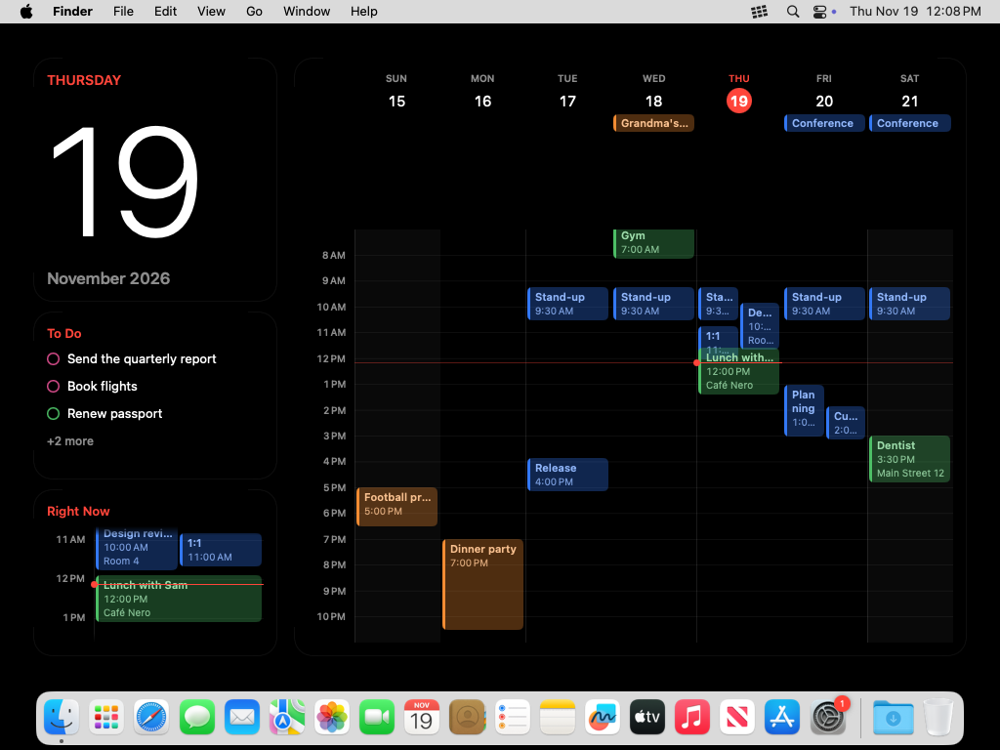

# Blotter

Blotter puts your calendar on the desktop. It sits behind your icons and windows, on every Space, and shows today's date, your reminders, what's happening right now, and the whole week. When you need it, bring it to the front with a keyboard shortcut.



Blotter was a Mac App Store app from 2010 to 2020. Version 3 is a rewrite in Swift and SwiftUI for current macOS, released as open source under the Apache License 2.0.

## Features

- Week view, fitted to the day's events, with overlapping events laid out side by side.
- All-day events, a To Do list of incomplete reminders, and a Right Now view of the current hour.
- Choice of display, size (narrow, normal, full screen or custom) and position.
- Global shortcuts to bring the calendar to the front, add events and reminders, and move between weeks.
- Optional fade when idle, a rolling seven-day view, and calendar selection.
- No analytics or tracking. Blotter talks to nothing but your local calendar database.

## Requirements

- macOS 14 Sonoma or later.
- Xcode 26 or later to build.

## Building

```sh
open Blotter.xcodeproj
```

Then build and run the **Blotter** scheme. Blotter asks for access to your calendars and reminders on first launch.

The Xcode project is generated from `project.yml` with [XcodeGen](https://github.com/yonaskolb/XcodeGen). After adding or moving files, or changing build settings, regenerate it and commit the result:

```sh
xcodegen
```

## Project layout

| Path | Contents |
| --- | --- |
| `Blotter/` | The macOS app: AppKit windows and menu bar item, SwiftUI views, EventKit access. |
| `BlotterKit/` | A Swift package with the platform-independent logic: date ranges, week and event layout, window geometry. |

## Testing

`BlotterKit` holds the logic worth testing, and its tests run on macOS and Linux:

```sh
swift test --package-path BlotterKit
```

The Blotter scheme in Xcode runs the same tests.

## Localization

Blotter is translated into English, German, Spanish, French, Japanese, Korean, Russian and Swedish. Strings live in the String Catalogs `Blotter/Resources/Localizable.xcstrings` (the interface) and `Blotter/Resources/InfoPlist.xcstrings` (permission prompts and copyright).

Use string literals in SwiftUI views, or `String(localized:)` in AppKit code, so Xcode picks new strings up into the catalog when you build. CI fails if any string is missing a translation:

```sh
python3 scripts/check_localizations.py
```

## Formatting

Code is formatted with `swift format`, which ships with Xcode:

```sh
swift format -i -r Blotter BlotterKit/Sources BlotterKit/Tests
```

## History

The repository keeps the full history of the original Objective-C app, going back to 2010. The last Objective-C release is tagged `v2.2.4`.

## License

[Apache License 2.0](LICENSE)
